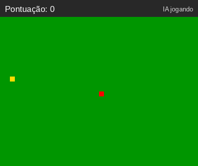

# Matheus Henrique "Theus" Gomes

**Matemática Aplicada  |  Modelagem  |  Ciência de Dados**

Só para deixar aqui uns resultados de litros de água gastos com algumas LLM's

 

---

## Sobre

Graduando em Matemática Aplicada e Computacional pela Universidade Federal de Goiás, com interesse em Modelagem Matemática/Estatística, Economia Matemática e Sistemas Dinâmicos. As vezes rabiscos uns códigos, faço umas contas e erro matemática básica.

---

## Anakonda. Clique para jogar

[▶ Jogar como humano](https://gmatheushq.github.io/cobrinhaatt/?modo=humano) · [🤖 Ver a IA jogando ao vivo](https://gmatheushq.github.io/cobrinhaatt/?modo=ia)

---

## Projetos selecionados

<table>
<tr>
<td width="50%" valign="top">

### CreditRisk
*Análise de Risco de Crédito*

Análise e modelagem de inadimplência a partir de dados de clientes e transações. 

- Abordagem: Regressão logística e Teoria dos Conjuntos Fuzzy
- Validação: Validação cruzada e literatura
- Resultado: em andamento

[Ver repositório](https://github.com/gmatheushq/CreditRisk)

</td>
<td width="50%" valign="top">

### Modelagem de Taxa de Câmbio
*Previsão e análise de série temporal cambial*

Abordagem de uma técnica para modelagem do comportamento da taxa de câmbio em diferentes níveis de um choque econômico.

- Abordagem: Modelo de Reversão à média Ornstein-Uhlenbeck; Cadeia de Markov; Simulação Monte-Carlo
- Avaliação: Estudo Especial BC nº 25/2018
- Resultado: Os resultados foram 100% favoráveis para o modelo em choques de até 10%, via simulação computacional.

[Ver repositório](https://github.com/gmatheushq/modelagem_tx_cambio)

</td>
</tr>
<tr>
<td width="50%" valign="top">

### Compressão de Imagens com SVD
*Álgebra linear Computacional*

Estudo da aplicação da SVD em imagens digitais, comprimindo dados e preservando qualidade visual.

- SVD é uma ferramenta onde o custo/benefício computacional é alto
- Existe uma faixa onde a variação da qualidade visual (PSNR) é lenta, mas a compressão é linear, é onde há gamho
- É notório que existem ferramentas teóricas a serem desenvolvidas ao favor da SVD
  

[Ver repositório](https://github.com/gmatheushq/ImageCompression-SVD)

</td>
<td width="50%" valign="top">

### Atos29-lib
*Aplicativo*

lib de um app feito no flutter, direcionado para o público católico, a ideia é para ser uma rede social para um grupo especifico onde aborda, além da nova proposta social, ferramentas presentes em outros apps, tais como novenas, liturgia diária, agenda, rotina guiada entre outros.

[Ver repositório](https://github.com/gmatheushq/Atos29-lib)

</td>
</tr>
</table>

<b>Outros repositórios</b>

 

- [novena-api](https://github.com/gmatheushq/novena-api) — *API de novenas*
- [oracoes-api](https://github.com/gmatheushq/oracoes-api) — *API de orações*
- [cobrinhaAI](https://github.com/gmatheushq/cobrinhaAI) — *RandomForest no Jogo da Cobrinha*

Lista completa: [github.com/gmatheushq?tab=repositories](https://github.com/gmatheushq?tab=repositories)

---

## Formação e pesquisa

|  Período  | Atividade | Instituição |
|---|---|---|
| 2024 – Atual | Graduação em Matemática Aplicada e Computacional | UFG |
| 2026 – Atual | PIBIC(CNPq) - Análise de Crédito, Tomada de Decisão e Incerteza Inerente | UFG |
| 2026 – Atual | PIBIC - Análise de conjuntos invariantes em sistemas dinâmicos com suporte de métodos computacionais | UFG |
| 2025 – 2026 | PIBIC(CNPq) - Compressão de Imagens via Decomposição em Valores Singulares (SVD) | UFG |

Produção acadêmica completa e detalhada no [Currículo Lattes](https://lattes.cnpq.br/6837885816567736).

---

 

<a href="https://www.linkedin.com/in/matheus-henrique-7026072aa/">LinkedIn</a>  ·  <a href="mailto:SEU-EMAIL">matheusemog271@gmail.com</a>  ·  <a href="https://lattes.cnpq.br/6837885816567736">Lattes</a>

